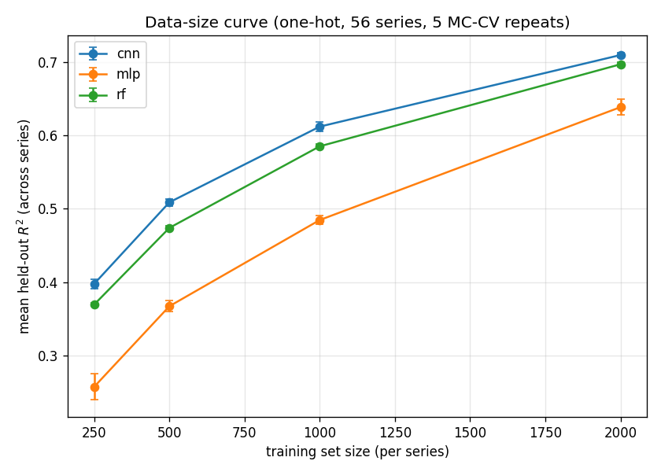

# Reproduction report — 2026-11-02-2026-11-02-full56

> **Superseded as the canonical registry on 2026-11-02 — but not as a measurement.** Replaced by
> `2026-11-02-full56-seeds`, which holds **three model-init seeds** where this one holds one, and
> so can be paired seed-matched against a candidate (audit ML-01b, DECISIONS #69, #73). Seed 1 of
> the replacement reproduces every one of these 3,360 values: **cnn and mlp bit-identical**
> (1120/1120 each, max |Δ| exactly 0), **rf to 3.3e-16** (803/1120 bit-identical) — and that rf
> residual is its own `n_jobs=-1` thread-accumulation nondeterminism, measured independently at
> 1.1e-16, not an effect of the rebuild. Quote these numbers freely; just don't use this registry
> as a control, because its guard refuses it (two value-deciding files changed under it) and it
> cannot supply a seed component.
>
> It was the first registry whose run-cards carry a per-file provenance manifest, so a change in
> the definition of the value-deciding file set can be re-checked file by file instead of
> invalidating these values wholesale (DECISIONS #65) — which is exactly what happened here, and
> why the refusal above is precautionary rather than a finding. It reproduces `2026-11-01-full56`
> to **3.3e-16** (3,066 of 3,360 rows bit-identical). The doubled date in the name is the builder
> prefixing `--tag`; the artifacts are left exactly as the run wrote them.
>
> Protocol lineage and what the older registries are refused for:
> [docs/RETRACTIONS.md](../../docs/RETRACTIONS.md) R-5 and its 2026-11-02 method note.

Scripted baseline reproduction of Nikolados et al. (2022) sequence-to-expression prediction. **No notebooks executed.**

- dataset_hash: `e15d854d7a648273...`  ·  split_hash: `c20f19717f3b0f38...`
- models: rf, mlp, cnn  ·  feature set: one-hot (96×4)
- series: 56 of 56 ([1, 2, 15, 20, 25, 26, 30, 33, 35, 37, 44, 46, 47, 49, 50, 54, 56, 60, 71, 76, 84, 86, 88, 95, 99, 102, 117, 133, 136, 141, 145, 156, 158, 192, 205, 221, 227, 247, 255, 277, 284, 299, 314, 321, 329, 340, 343, 344, 349, 355, 359, 379, 380, 382, 384, 387])
- MC-CV repeats (iterations): [1, 2, 3, 4, 5]  ·  train seed: 1
- primary metric: R² on each series' fixed held-out set, averaged across series then across repeats.

## Data-size curve

| model | train_size | r2_mean | r2_std |
| --- | --- | --- | --- |
| cnn | 250 | 0.3979 | 0.0066 |
| cnn | 500 | 0.5088 | 0.0049 |
| cnn | 1000 | 0.6118 | 0.0062 |
| cnn | 2000 | 0.7092 | 0.0033 |
| mlp | 250 | 0.2578 | 0.0175 |
| mlp | 500 | 0.3674 | 0.0073 |
| mlp | 1000 | 0.4847 | 0.0058 |
| mlp | 2000 | 0.6383 | 0.0104 |
| rf | 250 | 0.3697 | 0.0021 |
| rf | 500 | 0.474 | 0.0029 |
| rf | 1000 | 0.585 | 0.0028 |
| rf | 2000 | 0.6966 | 0.0032 |

## CNN vs classical @ train_size=2000

| model | r2_mean | r2_std |
| --- | --- | --- |
| cnn | 0.7092 | 0.0033 |
| rf | 0.6966 | 0.0032 |
| mlp | 0.6383 | 0.0104 |

## Notes

- R² increases with training-set size for every model (expected data-efficiency trend), reproducing the paper's qualitative finding.
- **Complete baseline registry**: all 56 mutational series × 5 Monte-Carlo CV repeats. This is the canonical baseline that agentic experiments compare against.
- Per-(series,size,model,iteration) rows: see `experiments/runs/2026-11-02-2026-11-02-full56/metrics.csv`.
