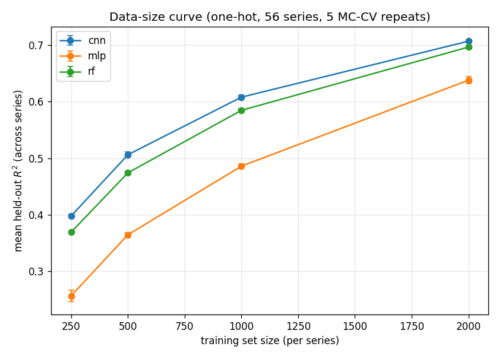

# Reproduction report — 2026-11-02-full56-seeds

> **The canonical registry** (`configs/baseline_registry.yaml`), from 2026-11-02. It replaces
> `2026-11-02-2026-11-02-full56` for one reason: that registry held a single model-init seed, and a
> single-seed baseline cannot be paired seed-matched against a candidate's three, which is the
> defect audit ML-01b was about (DECISIONS #69, #73). This one is `--model-seeds 1 2 3` over all 56
> series × 5 iterations × 4 train sizes × 3 models — 10,080 fits, a rectangular grid with no cell
> short.
>
> **The replacement changed no number.** Seed 1 here reproduces all 3,360 values of the registry it
> replaces: cnn and mlp **bit-identical** (1120/1120 each), rf to **3.3e-16**, which is rf's own
> `n_jobs=-1` thread-accumulation nondeterminism rather than an effect of the rebuild. So the
> predecessor's numbers stand as measurements and are superseded only as a *control*.
>
> The three seeds are not only for pairing: they give the per-series permutation null **45**
> `(iteration, model, seed)` blocks instead of 15 (DECISIONS #72).
>
> Protocol lineage and what the older registries are refused for:
> [docs/RETRACTIONS.md](../../docs/RETRACTIONS.md) R-5 and its 2026-11-02 method note.

Scripted baseline reproduction of Nikolados et al. (2022) sequence-to-expression prediction. **No notebooks executed.**

- dataset_hash: `e15d854d7a648273...`  ·  split_hash: `c20f19717f3b0f38...`
- models: rf, mlp, cnn  ·  feature set: one-hot (96×4)
- series: 56 of 56 ([1, 2, 15, 20, 25, 26, 30, 33, 35, 37, 44, 46, 47, 49, 50, 54, 56, 60, 71, 76, 84, 86, 88, 95, 99, 102, 117, 133, 136, 141, 145, 156, 158, 192, 205, 221, 227, 247, 255, 277, 284, 299, 314, 321, 329, 340, 343, 344, 349, 355, 359, 379, 380, 382, 384, 387])
- MC-CV repeats (iterations): [1, 2, 3, 4, 5]  ·  subsample seed: 1  ·  model-init seeds: [1, 2, 3]
- primary metric: R² on each series' fixed held-out set, averaged across series then across repeats.

## Data-size curve

| model | train_size | r2_mean | r2_std |
| --- | --- | --- | --- |
| cnn | 250 | 0.3977 | 0.0033 |
| cnn | 500 | 0.5061 | 0.0049 |
| cnn | 1000 | 0.6079 | 0.0041 |
| cnn | 2000 | 0.7069 | 0.0027 |
| mlp | 250 | 0.2566 | 0.0099 |
| mlp | 500 | 0.3645 | 0.0041 |
| mlp | 1000 | 0.4859 | 0.004 |
| mlp | 2000 | 0.6379 | 0.0066 |
| rf | 250 | 0.3691 | 0.0016 |
| rf | 500 | 0.4741 | 0.0024 |
| rf | 1000 | 0.5846 | 0.0028 |
| rf | 2000 | 0.6965 | 0.0028 |

## CNN vs classical @ train_size=2000

| model | r2_mean | r2_std |
| --- | --- | --- |
| cnn | 0.7069 | 0.0027 |
| rf | 0.6965 | 0.0028 |
| mlp | 0.6379 | 0.0066 |

## Notes

- R² increases with training-set size for every model (expected data-efficiency trend), reproducing the paper's qualitative finding.
- **Complete baseline registry**: all 56 mutational series × 5 Monte-Carlo CV repeats. This is the canonical baseline that agentic experiments compare against.
- Per-(series,size,model,iteration) rows: see `experiments/runs/2026-11-02-full56-seeds/metrics.csv`.
